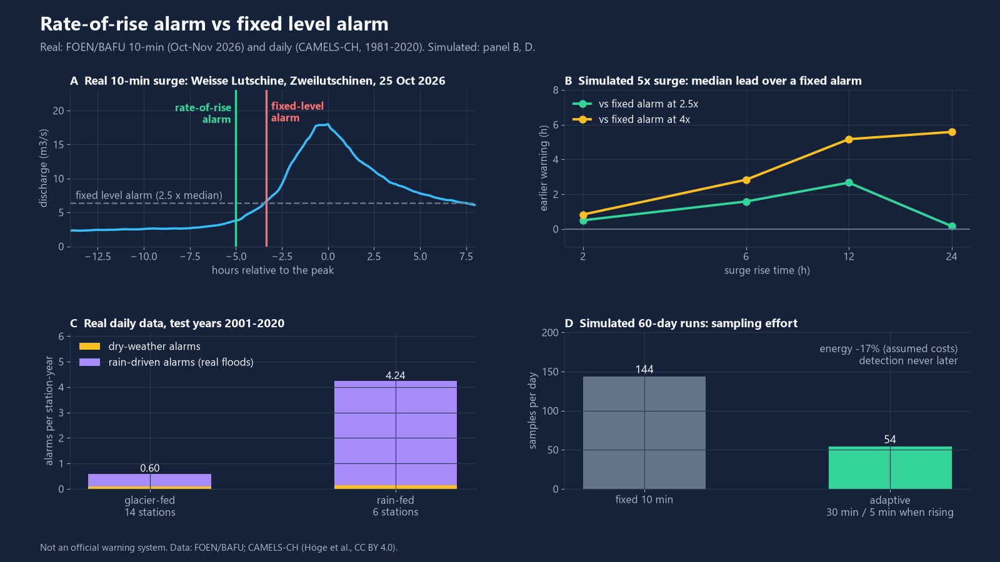
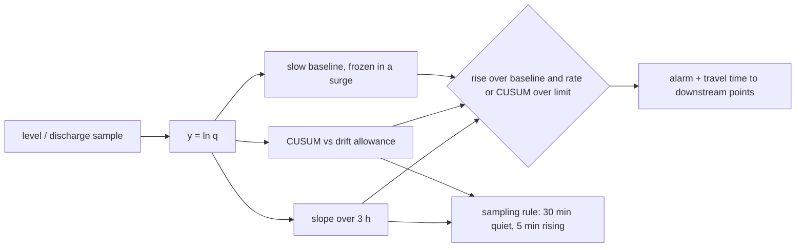

# lake-outburst-alarm

A rate-of-rise alarm for glacial-lake outbursts and sudden river surges, built for low-power level sensors downstream: it watches how fast the water climbs, not how high it is, and it samples faster only while the water is rising.



Panels A, C: real FOEN/BAFU data. Panels B, D: simulated surges (labelled as such).

## What it does

- **Rate-of-rise detector** on discharge (log scale) or stage (linear): least-squares slope over a short window, plus a slow baseline that freezes while a surge is under way.
- **CUSUM change detector** for slower, persistent rises that stay under the rate threshold.
- **Fixed-level alarm** as the baseline to compare against.
- **Travel-time estimate** from the sensor to downstream points (Manning, wide channel, kinematic wave celerity 5/3 of mean velocity).
- **Battery-aware sampling rule**: quiet interval 30 min, 5 min while rising (held for 6 h), quiet interval doubled when the battery is low; fast samples are buffered, the radio is used hourly and while alarmed.

Pure Python + numpy, streaming (one sample in, one status out), so the same code can be ported to a microcontroller.

## Results

All numbers come from `python -m lakealarm demo` (written to `data/results.json`).

| What | Result | Data |
|---|---|---|
| Lead over a fixed level alarm, **real 10-min surge** (Weisse Lutschine, 25 Oct 2026) | **+1.7 h** (alarm at -5.0 h vs -3.3 h before the peak) | real, FOEN/BAFU, 10-min |
| Same, all 12 real station-events in 40 days (3 natural-flow stations) | lead defined for 10: median **+1.9 h**, range -0.3 h to +7.7 h; for 2 the fixed alarm was still on from the flood before | real, 2026-10-02 to 2026-11-11 |
| Lead over a fixed alarm at 2.5x median, simulated 5x surge | 0.2 h (24 h rise) to 2.7 h (12 h rise); 24 h rise with 3x peak: detected 14/20 | simulated, 20 trials per cell |
| Same against a fixed alarm at 4x median | 0.8 h (2 h rise) to 5.6 h (24 h rise); the fixed alarm missed every 3x surge | simulated |
| Lead on **real daily data**, 87 confirmed flood station-events | 0.4 d mean where both alarmed (8 earlier, 30 same day, 2 later); detector alarmed on 48/87, fixed P99 level on 56/87 | real, CAMELS-CH 1981-2020 |
| **Dry-weather false alarms**, glacier-fed stations, test years 2001-2020 | **0.09 per station-year** (26 alarms, 279 station-years) | real daily |
| All alarms outside flood windows, glacier-fed / rain-fed, 2001-2020 | 0.60 / 4.24 per station-year; 84 % / 96 % of them rain-driven (real unlabelled floods, counted as false for a lake alarm) | real daily |
| False alarms, simulated surge-free background (diurnal amplitude 30 % and 60 %) | 0 in 5 simulated station-years each | simulated |
| False alarms on real 10-min records, natural-flow stations | 8 in 0.66 station-years | real, 6 stations, 40 days |
| Same, stations with a daily release pattern | 47 alarms in 0.33 station-years: not usable there | real, 3 stations |
| Adaptive sampling vs fixed 10 min | **-62 % samples** (144 to 54 per day); energy **-17 %**, mean power 98 to 81 uW under **assumed** costs (20 mJ per sample, 150 mJ per uplink, 20 uW sleep); detection never later than fixed (mean -4.6 min, max 0 min), 12 runs | simulated |
| Travel time, assumed reaches (6 km and 21 km), 20 to 150 m3/s | 17 to 8 min and 90 to 40 min | assumed geometry |

Reading the table honestly: at daily resolution the rise happens inside one sample, so there is almost no lead over a high fixed level; the benefit shows at 10-minute resolution and for slow rises. The detector is tuned for lake-outburst-like surges, so every rain flood is also an alarm.

## Quick start

```bash
uv venv .venv --python 3.12
uv pip install --python .venv/Scripts/python.exe -e ".[dev]"   # Linux/macOS: .venv/bin/python
python -m lakealarm demo            # reproduces the numbers above, writes docs/*.png
python -m lakealarm demo --no-figures --no-live
python -m lakealarm travel --q 100 --length-km 10 --slope 0.04 --width-m 12
python -m lakealarm fetch           # optional: official FOEN 40-day records into cache/
python -m lakealarm tune            # re-derive the daily setting (about 10 minutes)
python -m pytest -q                 # 89 tests
```

```python
from lakealarm import DetectorConfig, RateOfRiseDetector

det = RateOfRiseDetector(DetectorConfig())
status = det.update(t_hours, discharge_m3s)  # status.alarm, status.reason, status.rate
```

`demo` without cached 10-minute data (`cache/foen40d/<date>/`, or a relay file from `fetch --source relay`) skips the live part. The 40-day window moves on every day, so only the numbers in `data/results.json` are frozen (records retrieved 2026-11-12); the committed daily fixture reproduces everything else exactly.

## How it works



- Alarm when `ln q` is at least `ln 1.5` above the baseline **and** the slope is at least 0.12 per hour (about +13 % per hour) **or** the CUSUM (allowance 0.025 per hour, limit 0.6) is over its limit. The latch clears when the level falls back.
- The daily setting (factor 2.0 per day, 3.0 over baseline, CUSUM 5.0) is the most sensitive grid point with at most 0.1 dry-weather false alarms per station-year on **1981-2000**; no event data was used. The 2001-2020 years are the held-out test. Re-run with `python -m lakealarm tune`.
- Fixed baseline: the daily P99 of the station (real daily data), or 2.5x the station median (10-minute and simulated data). 4x is shown as the more typical warning-level case.
- "Rain-driven" means basin precipitation of at least 15 mm on the alarm day or the day before (from CAMELS-CH).
- Confirmed events: a catalogue window of a documented Swiss flood (1987-08, 1993-09, 1999-05, 2000-10, 2005-08, 2020-10; dates checked against federal reports, see [Data sources](#data-sources)) counts at a station only if that station's daily peak inside the window is at least 2.5x the median of the 30 days ending 3 days before. That gave 87 of 120 possible station-events (median peak ratio 3.3 to 6.7 per flood). Real 10-minute events are peaks of at least 2.5x the median of the window 24 to 96 h before. Peaks are taken from the highest sample down, and each one claims 48 h on both sides even when it cannot be confirmed (too little history before it), so a flood at the start of the record is never reported from a later blip on its falling limb. Lead on real data uses, for both alarms, the onset of the last alarm episode (episodes merged within 12 h) that starts between 36 h before and 1 h after the peak; an earlier, separate detector episode in that window counts as a false alarm, and if the fixed alarm is still on from a previous flood the lead is left undefined. A real flood is not a lake outburst; it is used here because it is a verifiable sudden surge.

## Data sources

| Data | Used for | Source and licence |
|---|---|---|
| Daily discharge, basin precipitation and temperature, 20 gauges, 1981-2020 | event confirmation, lead time, false alarms | **CAMELS-CH** (Hoge, Kauzlaric, Siber, Schonenberger et al.), Zenodo record 15025258, **CC BY 4.0**. Discharge originates from the Swiss Federal Office for the Environment (FOEN/BAFU). Subset committed as `data/daily_q_subset.csv.gz` (2.7 MB). Source: FOEN/BAFU via CAMELS-CH. |
| 10-minute discharge, 9 stations (a 10th, 2269, has no 40-day record), 2026-10-02 22:00 to 2026-11-11 22:20 UTC | real surge example, real 10-min events and false alarms | Official FOEN/BAFU 40-day records of [hydrodaten.admin.ch](https://www.hydrodaten.admin.ch/) (5-minute provisional raw values; those on the 10-minute grid are used), retrieved 2026-11-12. The FOEN [FAQ](https://www.hydrodaten.admin.ch/de/fragen) states that the data can be used freely and recommends naming the source (Abteilung Hydrologie, Bundesamt für Umwelt BAFU, with the retrieval date); the FOEN conditions for current raw data ([AGB, 16.09.2019](https://www.bafu.admin.ch/dam/de/sd-web/5NAitqNKub6m/allgemeine_bedingungenfuerdasherunterladenaktuellerhydrologische.pdf)) allow commercial and non-commercial use. The raw series is **not committed**: `python -m lakealarm fetch` downloads it into the gitignored `cache/`, and `data/results.json` holds only derived values. `fetch --source relay` uses the unofficial relay api.existenz.ch instead (last 32 days). Source: FOEN/BAFU. |
| Simulated surges and background | lead-time grid, simulated false alarms, energy | generated by `lakealarm/sim.py`, seeded, labelled simulated everywhere |

Historic 10-minute FOEN data is **not openly downloadable**: the FOEN portal shows the last 40 days and the current-year tables, older data is ordered from its [Hydrological Data Service](https://www.bafu.admin.ch/en/hydrological-data-service-for-watercourses-and-lakes). That is why long-record results here are daily, and sub-daily results use simulated surges or the 40-day real window. See `data/ATTRIBUTION.md`.

### Flood catalogue: dates and sources

Each window in `lakealarm/events.py` was checked on 2026-11-11 against a federal report or event page. No window had to change.

| Window in code | Documented event | Source |
|---|---|---|
| 1987-08-23 to 08-26 | Storms of 24/25 Aug 1987: floods and landslides mainly in Uri (Reuss plain flooded), Goms, Val Poschiavo and Valtellina; 8 deaths | FOEN, [short history of natural hazards](https://www.bafu.admin.ch/de/kurze-geschichte-der-naturgefahren-in-der-schweiz) |
| 1993-09-22 to 09-25 | Heavy rain 22-25 Sep 1993 in Upper Valais and Ticino; Saltina flood in Brig on 24 Sep 1993 | MeteoSwiss, [event 22-25 Sep 1993](https://www.meteoschweiz.admin.ch/klima/klima-der-schweiz/rekorde-und-extreme/extremwertanalysen/folgenschwere-niederschlagsereignisse/22-september-25-september-1993.html); SRF, [Brig 24 Sep 1993](https://www.srf.ch/news/bern-freiburg-wallis-vor-20-jahren-verwuesteten-wasser-und-schlamm-die-stadt-brig) |
| 1999-05-20 to 05-23 | Pentecost event, rain 20-22 May 1999 (second of two May 1999 floods; the earlier Ascension event of 11-15 May is **not** in the catalogue) | FOEN (then BWG), [Hochwasser 1999, Hydrologische Mitteilungen Nr. 28](https://www.bafu.admin.ch/dam/it/sd-web/gduCKYNgRci8/hochwasser_1999_analysedermessdatenundstatistischeeinordnung.pdf) |
| 2000-10-13 to 10-16 | Persistent rain 10-16 Oct 2000 in Valais and Ticino, heaviest 13-15 Oct (Gondo landslide 14 Oct) | FOEN (then BWG), [Hochwasser 2000, Ereignisanalyse](https://www.bafu.admin.ch/dam/de/sd-web/2AexaLRRor9M/hochwasser_2000_ereignisanalysefallbeispiele.pdf) |
| 2005-08-21 to 08-23 | Heavy rain 19-23 Aug 2005; e.g. the Kander at Hondrich peaked on 22 Aug 2005 | MeteoSwiss, [event 19-23 Aug 2005](https://www.meteoschweiz.admin.ch/klima/klima-der-schweiz/rekorde-und-extreme/extremwertanalysen/folgenschwere-niederschlagsereignisse/19-august-23-august-2005.html); FOEN, [Oct 2011 event page](https://www.bafu.admin.ch/de/hochwasserereignis-vom-1011-oktober-2011) |
| 2020-10-02 to 10-04 | Rain 1-3 Oct 2020, main event 2-3 Oct, south side of the Alps, Upper Valais, Bernese Oberland, Uri | FOEN, [2-5 Oct 2020 flood](https://www.bafu.admin.ch/de/2-bis-5-oktober-2020-hochwasser-auf-der-alpensuedseite-und-in-den-alpen) |

Other real-world facts in this README:

- 10-minute events (Weisse Lutschine at Zweilutschinen peak 18.0 m3/s at 18:30 UTC on 25 Oct; Emme at Emmenmatt peak 9.8 m3/s at 22:40 UTC on 8 Oct, first reached at 22:35 in the 5-minute values; Lutschine at Gsteig): taken from the FOEN 40-day records retrieved 2026-11-12 ([2200](https://www.hydrodaten.admin.ch/de/seen-und-fluesse/stationen-und-daten/2200), [2109](https://www.hydrodaten.admin.ch/de/seen-und-fluesse/stationen-und-daten/2109), [2070](https://www.hydrodaten.admin.ch/de/seen-und-fluesse/stationen-und-daten/2070)).
- Gornersee drains almost every year within a few days: Huss, Bauder, Werder, Funk and Hock (2007), J. Glaciol. 53(181), 189-200, [doi:10.3189/172756507782202784](https://doi.org/10.3189/172756507782202784).
- Vispa at Visp catchment 786 km2: FOEN [station 2351](https://www.hydrodaten.admin.ch/de/seen-und-fluesse/stationen-und-daten/2351).
- CAMELS-CH record, licence and 331 catchments: [Zenodo 15025258](https://zenodo.org/records/15025258).

## What is not verified yet

- **This is not an official warning system** and must not be used as one. It has no field deployment, no customers and no review by a hydrology service.
- **No real glacial-lake outburst is in the evaluation.** I checked the Mattervispa / Vispa gauge at Visp (it integrates the Gornersee catchment) for 2004 and 2005; Gornersee drains almost every year within a few days (Huss et al. 2007, J. Glaciol.), but the drainage is not identifiable in the daily means of a 786 km2 regulated catchment, so I did not claim any Gornersee date. Outburst-shaped surges are simulated, with a simple exponential rising limb that is not calibrated to any lake.
- The real surges are rain floods. The six flood-window dates were checked against federal reports (table above); each station-event is still confirmed only by its own hydrograph (87 of 120 possible station-events pass). The windows are a few days wide and were not tuned per station.
- Real 10-minute evidence is small: 40 days, 9 stations, 12 events at 3 stations on 5 days (8, 10, 21 and 25 Oct, 10 Nov 2026). The lead range is -0.3 h to +7.7 h; the large values (5.5 to 7.7 h) all come from the Emme, a low-flow station whose fixed level is only 1.8 m3/s. There the fixed alarm also stayed on for days after a flood, so 2 of its 5 events have no lead.
- One of the 8 natural-flow false alarms is a single 10-minute spike in the provisional raw data (Emme, 7 Oct 2026 11:50 UTC, 0.40 to 0.76 m3/s and back) that trips the CUSUM. A spike filter would remove it; none is built in.
- **Changed on 2026-11-12:** the first results used the relay's 32-day window (from 2026-10-08 01:00 UTC). The Emme flood of 8 Oct peaked in its first 32 h, where the event finder lacked the history it needs, and it labelled a 15-minute blip on the falling limb (5.6 m3/s, 9 Oct 09:30 UTC) as the peak. The experiment now runs on the official FOEN 40-day records (from 2026-10-02 22:00 UTC), which cover the true peak (9.8 m3/s, 8 Oct 22:40 UTC), and the finder no longer lets an unconfirmable peak pass its label to a later blip (regression tests in `tests/test_live_regression.py`). The longer history also exposed an alarm on a raw-data spike 35 h before that flood, which the old "first alarm in the window" lead would have counted as +27 h of warning; the lead now uses the alarm episode that leads into the peak (see How it works). Old vs new: 6 events, median lead +1.4 h, range -1.8 to +9.8 h, 7 false alarms in 0.52 station-years; now 12 events (10 with a lead), median +1.9 h, range -0.3 to +7.7 h, 8 in 0.66 station-years. The example lead went from +1.5 h to +1.7 h because the fixed level is 2.5x the 40-day median.
- At 10-minute resolution the detector fired 7 times on natural-flow stations in 0.52 station-years; at stations downstream of regulated releases (a repeating daily peak) it fires about daily. Do not install it there without a release filter.
- Rain floods are alarms by design; the daily test shows 4.2 alarms per station-year at rain-fed stations.
- Energy numbers use **assumed** per-event costs, not measured hardware. Sample reduction (-62 %) is a count and does not depend on them.
- Travel-time reaches are made-up geometry; Manning roughness and the wide-channel assumption are not validated against any survey.
- For the committed daily subset I rely on the CC BY 4.0 licence of the CAMELS-CH record; the FOEN conditions for current raw data allow commercial and non-commercial use with the source named, but do not address republishing of the archived daily series.
- Detector thresholds were tuned on daily data and checked on a 20-year hold-out, but not on 10-minute multi-year records.

## Licence

MIT, Copyright (c) 2026 Victor Bonilla. The daily data subset keeps its own licence (CC BY 4.0, see above).
